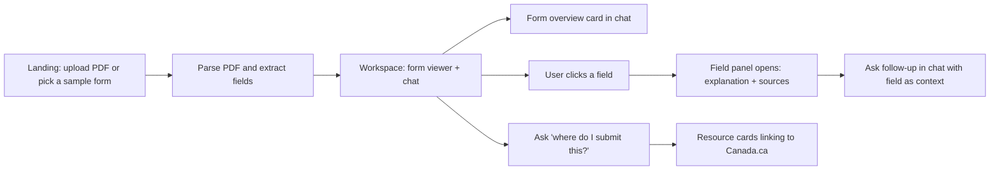
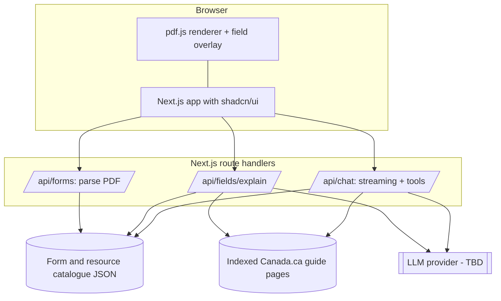

# MVP design: Government Form Helper & Service Navigator

- Status: Draft for team review
- Source idea: [ideas.md](ideas.md) — "Government Form Helper & Service Navigator"
- Default scope: Government of Canada (federal) forms and services
- Proposed stack: [0001: Web stack and UI kit](decisions/0001-web-stack-and-ui-kit.md)

## 1. Problem and users

Federal forms (passport, benefits, tax, immigration) use dense, legalistic
wording and point to guides spread across many Canada.ca pages. People abandon
forms, make avoidable mistakes, or cannot find the right service.

Primary users:

- Residents completing a federal form for the first time.
- Newcomers and people with limited English or French reading confidence.
- Helpers (family members, settlement workers) explaining a form to someone else.

## 2. MVP goals

1. **Upload a form** (PDF) and get a plain-language overview: what it is, who
   files it, what you need, and where to submit it.
2. **Click any field** on the rendered form to open a side panel ("field
   canvas") that explains that field in plain language, with format, examples,
   common mistakes, and official sources.
3. **Chat about the form** with the field you selected as context.
4. **Navigate to resources**: the assistant links to the official Canada.ca
   service page, guide, eligibility page, or online portal.

### Non-goals for the MVP

- Filling in, saving, or submitting forms on the user's behalf.
- Legal, immigration, or tax advice. The assistant explains; it does not decide.
- User accounts, history, or persistent storage of uploaded documents.
- Provincial or municipal forms (possible later; see section 11).

## 3. Core user flow



## 4. Screen design (shadcn/ui)

### 4.1 Landing

- Centred `Card` with a drag-and-drop upload zone (`Input type="file"`
  styled as a dropzone), accepted type `.pdf`, size limit shown.
- "Try a sample form" row: 3–4 `Button variant="outline"` chips for the seeded
  demo forms (section 8).
- `Alert` with a privacy note: "Upload a blank form. Don't include personal
  information." (see section 9).
- Below: a `Command` search box, "What do you need to do?" (for example "renew
  passport"), that jumps straight into navigator chat without a form.

### 4.2 Workspace (desktop)

Three resizable panes using `ResizablePanelGroup`, similar to the canvas mode in
other chat assistants:

```text
+--------------------------------------------------------------------------------+
| [Logo] Form Helper    PPTC 153 · Adult passport application     [EN|FR] [New]  |
+------------------------+------------------------------------+------------------+
| CHAT (ScrollArea)      | FORM VIEWER                        | FIELD PANEL      |
|                        |  [< Page 1 / 4 >]  [- 100% +]      | (opens on click) |
| ┌ Form overview card ┐ |  ┌──────────────────────────────┐  |                  |
| │ What: ...          │ |  │ 1. Surname   [▓▓▓▓▓▓▓▓▓▓▓]   │  | Surname     [x]  |
| │ Who files: ...     │ |  │ 2. Given names [▓▓▓▓▓▓▓▓▓]   │  | Badge: Required  |
| │ You'll need: ...   │ |  │ 3. Date of birth [░░░░░░] ◄──┼──| Badge: Text      |
| │ Submit at: [link]  │ |  │ ...                          │  | ---------------- |
| └────────────────────┘ |  │ (clickable field overlays)   │  | What it means    |
|                        |  └──────────────────────────────┘  | What to enter    |
| User: what is a        |                                    | Format & example |
| guarantor?             |  Fields on this page (Tabs):       | Common mistakes  |
|                        |  [All] [Required] [Explained]      | Related fields   |
| Bot: ... [Resource]    |                                    | Sources (links)  |
|                        |                                    | [Ask in chat ->] |
| ┌ Asking about: DOB x┐ |                                    |                  |
| │ [Type a message...]│ |                                    |                  |
+------------------------+------------------------------------+------------------+
```

- **Chat pane (left)**: message list in `ScrollArea`; assistant messages can
  contain a form overview `Card`, resource `Card`s, and field chips that, when
  clicked, highlight and open that field. Composer is a `Textarea` with a
  context `Badge` ("Asking about: Date of birth ✕") when a field is selected.
- **Form viewer (centre)**: PDF page rendered to canvas with an absolutely
  positioned overlay of transparent buttons, one per detected field. Hover shows
  a `Tooltip` with the field label; the selected field gets a ring highlight.
  Page controls, zoom, and a field list (`Tabs`: All / Required / Explained)
  provide a keyboard-accessible alternative to clicking on the page.
- **Field panel (right)**: collapsed by default; opens when a field is selected.
  Sections use `Accordion` (first two expanded). Loading uses `Skeleton`.
  Footer has "Ask in chat" and "Previous / Next field" buttons.

### 4.3 Mobile

- Form viewer is the main view; chat lives in a bottom `Drawer`.
- Field panel opens as a `Sheet` from the right (or bottom on small screens).

### 4.4 shadcn components used

`Button`, `Card`, `Badge`, `Input`, `Textarea`, `ScrollArea`,
`ResizablePanelGroup`, `Sheet`, `Drawer`, `Tabs`, `Accordion`, `Tooltip`,
`Alert`, `Skeleton`, `Separator`, `Command`, `Breadcrumb`, `DropdownMenu`
(language and actions), and `Sonner` (toasts). Theme: neutral base colour,
light and dark mode, with a single accent colour. Avoid styling that imitates
the official Canada.ca identity, so users do not mistake the tool for a
government service.

## 5. Field panel content

Each explanation is generated from the field's extracted metadata, nearby form
text, and matched official guide content, and returns this structure:

| Section | Content |
| --- | --- |
| Header | Field label, number on form, page, type (text, date, checkbox, choice), required flag if known |
| What it means | 1–3 sentence plain-language explanation (target reading level: grade 6–8) |
| What to enter | Concrete instructions; options explained for checkboxes and dropdowns |
| Format and example | For example, `YYYY-MM-DD`, `1990-04-15`; a fictional example only |
| Where to find it | Which document holds this information (for example, birth certificate, Notice of Assessment) |
| Common mistakes | Short bulleted list |
| Related fields | Chips that jump to dependent or related fields |
| Sources | Links to the official guide or Canada.ca page used, with section titles |
| Confidence | `Badge`: "From official guide" vs "AI explanation — verify" |

## 6. Architecture



### 6.1 Form parsing pipeline

1. **Render and extract** with pdf.js: page text, plus AcroForm widget
   annotations (`fieldName`, `alternativeText`, `rect`, `fieldType`,
   `options`). Many federal fillable PDFs put a useful description in the
   field tooltip (`alternativeText`), which is the best label source.
2. **Identify the form**: regex form numbers from page text (for example
   `PPTC 153`, `RC66`, `IMM 5257`) and match against the catalogue to load the
   official title, department, guide URLs, and service page.
3. **Normalise fields**: derive a human label (tooltip, then nearest text,
   then cleaned field name), group radio buttons, and order fields by page and
   position.
4. **Fallback** when there are no AcroForm fields (scanned or XFA-only PDFs):
   show the form read-only and let the user select a region; send that page
   region's text to the LLM. Several IRCC forms are XFA-based, so the demo should
   use forms already confirmed to parse well (see section 8).
5. **Strip values**: discard any filled-in field values before anything is sent
   to the LLM or logged.

### 6.2 Grounding and navigation

- **Catalogue (MVP)**: a hand-curated JSON file of demo forms and roughly 30–50
  high-value federal services (passports, CRA My Account, EI, CPP/OAS, CCB, SIN,
  IRCC visitor visa / PR, GCKey). Each entry has title, department, URL, short
  description, tags, and related forms.
- **Guide content**: fetch and chunk the official guides for the demo forms
  ahead of time; use simple keyword or embedding search to pass relevant
  excerpts to the LLM with their URLs.
- **Allowlisted links only**: the assistant may only render links whose host is
  `canada.ca` or ends in `.gc.ca`, and only from the catalogue or retrieved
  sources. No model-generated URLs.
- Reuse the LLM team's scraped data and pipeline where it fits; it targets
  Manitoba, so it is a stretch source rather than the MVP default.

### 6.3 Chat tools

The chat endpoint streams responses and exposes tools so the conversation can
drive the UI:

| Tool | Purpose |
| --- | --- |
| `getFormOverview()` | Summary card for the current form |
| `findField(query)` | Returns matching field IDs; the UI highlights and opens the first match ("Where do I put my UCI?") |
| `explainField(fieldId)` | Same payload as the field panel |
| `searchResources(query)` | Returns catalogue entries rendered as resource cards |

### 6.4 Core types (draft)

```ts
type FormDocument = {
  id: string;
  fileName: string;
  pageCount: number;
  formNumber?: string;          // "PPTC 153"
  catalogEntryId?: string;
  fields: FormField[];
};

type FormField = {
  id: string;
  page: number;
  rect: [number, number, number, number]; // PDF coordinates
  type: "text" | "checkbox" | "radio" | "choice" | "signature" | "unknown";
  rawName: string;
  label: string;
  tooltip?: string;
  options?: string[];
};

type FieldExplanation = {
  fieldId: string;
  meaning: string;
  whatToEnter: string;
  formatExample?: string;
  whereToFind?: string;
  commonMistakes: string[];
  relatedFieldIds: string[];
  sources: { title: string; url: string }[];
  grounded: boolean;            // true when backed by an official source
};

type Resource = {
  id: string;
  title: string;
  url: string;                  // canada.ca or *.gc.ca only
  department: string;
  description: string;
  tags: string[];
  relatedFormNumbers: string[];
};
```

## 7. Responsible AI and trust

- Always show sources; label ungrounded explanations clearly.
- Persistent footer disclaimer: "Not an official Government of Canada service.
  Check official guidance before submitting."
- Refuse to decide eligibility or give legal, immigration, or tax advice; link
  to the official eligibility page or a contact page instead.
- System prompt guards against prompt injection from uploaded PDF text (treat
  form text as data, never as instructions).

## 8. Demo forms (to verify)

Pick 3 forms that parse cleanly with pdf.js and have public guides. Candidates,
to be checked during research:

- **PPTC 153** — Adult general passport application (IRCC / Passport Program).
- **RC66** — Canada Child Benefits Application (CRA).
- **ISP-1000** — Application for a Canada Pension Plan retirement pension (ESDC).
- **IMM 5257** — Application for a visitor visa (IRCC); likely XFA, so use only
  if parsing works.

Record findings (fillable vs XFA, field count, tooltip quality, guide URL) in
[docs/research/](research/).

## 9. Privacy and security

- Encourage blank forms; warn before upload.
- Process files in memory; no persistent storage or logging of file contents.
- Strip field values before LLM calls; send only labels, tooltips, and form text.
- File limits: PDF only, size cap (for example 10 MB), page cap (for example
  30 pages).
- Prefer an LLM deployment hosted in Canada if available to the team.
- Keep API keys server-side; add variable names to `.env.example` when chosen.

## 10. Accessibility and language

- WCAG 2.1 AA: every field overlay is a focusable `button` with an accessible
  name; the field list provides full keyboard navigation; visible focus rings.
- Panel and chat announce updates with polite live regions.
- English first; French UI and explanations are a stretch goal, but parse
  bilingual labels from the start, since federal forms are bilingual.

## 11. Scope by priority

| Priority | Item |
| --- | --- |
| Must | Upload or sample PDF, render, clickable field overlay, field panel with explanation and sources, chat with field context, resource cards from catalogue |
| Should | Form overview card, `findField` highlight from chat, field list tabs, mobile layout |
| Could | Required-documents checklist per form, French UI, region-select fallback for non-fillable PDFs |
| Later | Provincial forms (Manitoba Forms Portal / AccessManitoba), saved sessions, read-aloud, guided fill-in mode |

## 12. Suggested hackathon workstreams

1. **UI**: landing, workspace layout, field panel, chat UI (shadcn).
2. **PDF**: rendering, field extraction, overlay coordinates, sample forms.
3. **AI**: prompts, structured field-explanation output, chat tools, guardrails.
4. **Content**: catalogue JSON, guide scraping and chunking, demo script.

## 13. Demo script (3 minutes)

1. Open the landing page and pick the passport sample form.
2. Read the overview card in chat (what it is, what you need, where to submit).
3. Click "Guarantor" on the form; the panel explains who qualifies, with the
   official guide link.
4. In chat, ask "Where do I put my old passport number?"; the field highlights.
5. Ask "Can I renew online instead?"; resource cards link to Canada.ca.

## 14. Open questions

- Which LLM provider and model, and is Canadian data residency required?
- Which three demo forms parse reliably (section 8)?
- Should the MVP include the required-documents checklist from the original idea?
- Is French support required for judging?
- Can the LLM team's scraped data be reused for federal pages?
